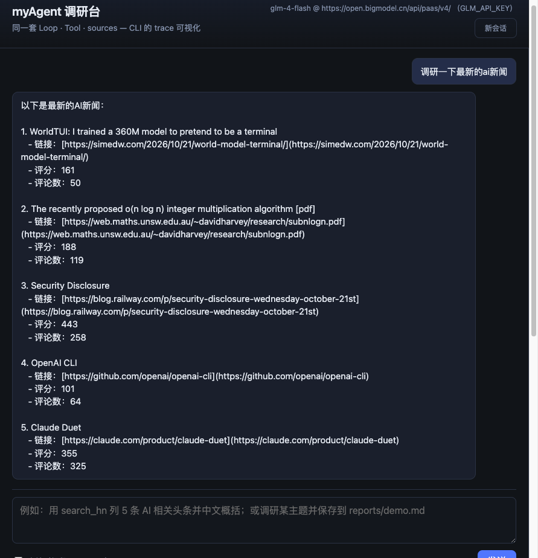

# 从零手写 Agent（六）：云模型 API Key 与网页调研台——Loop 仍不变

第五篇把 **CLI 调研 Agent** 跑通：搜、抓、sources、save。  
接下来两件事很自然：

1. **换更强推理** — 本地 7B 写长报告仍吃力，用 **OpenAI 兼容云端 API**（DeepSeek、OpenAI 等）只改配置，不改 Loop。
2. **把 trace 亮出来** — `-v --trace` 对开发者够用；给「调研工具」做一个 **网页台**，逐步看到 Step / Tool / 来源，比盯终端友好。

第六篇就这两块：**`LLM_*` 环境变量 + 薄 FastAPI 壳**，核心仍是 `_agent_loop`。

---

## 1. 云端 LLM：还是同一个 Chat Completions

仓库从一开始就用 **OpenAI Python SDK** 打 Ollama 的 `/v1`，所以换云模型不是换框架，而是换 **base_url + api_key + model 名**。

`.env` 示例（见仓库 `.env.example`）：

```env
# 本地默认
OLLAMA_BASE_URL=http://localhost:11434/v1
OLLAMA_MODEL=qwen2.5:7b

# 启用云端时（优先于 OLLAMA_*）
LLM_BASE_URL=https://api.deepseek.com/v1
LLM_API_KEY=sk-……
LLM_MODEL=deepseek-chat
```

`config.py` 合并为：

```text
LLM_BASE_URL  ← LLM_BASE_URL；或 LLM_PROVIDER=glm 时用智谱端点；否则 OLLAMA_BASE_URL
LLM_MODEL     ← LLM_MODEL；或 glm 默认 glm-4-flash；否则 OLLAMA_MODEL
LLM_API_KEY   ← LLM_API_KEY，或 shell 里的 GLM_API_KEY；都没有则占位 "ollama"
```

`agent/llm.py` 的 `create_client()` 始终 `OpenAI(base_url=..., api_key=...)`。**Tool 定义、messages、trim、save nudge 全不变。**

**注意：**

- **Key 只放 `.env`**，不要写进博文、不要 commit；发 DEV 时用占位符。
- 云端按 token 计费；联网 Tool 会把 **长网页摘要** 送回模型，费用和延迟都会上去 — 与第三篇 trim、Tool 内截断仍然相关。
- macOS 代理坑：`httpx.Client(trust_env=False)` 继续用于 localhost Ollama；云端 HTTPS 一般不受影响。

CLI 启动时会打印：

```text
LLM: deepseek-chat @ https://api.deepseek.com/v1 （API Key 已配置）
```

---

## 2. 为什么单独做网页，而不是再加一个 Tool？

调研 Agent 的「产品感」来自 **可观测的多步过程**：

```text
Step → 计划调哪些 Tool → 每次 Observation → sources 变长 → 最终答案 / Saved
```

CLI 的 `--trace` 已经包含这些信息，但对非终端用户不友好。网页要做的是：

| 层 | 职责 |
|---|---|
| **Loop**（已有） | 推理、Tool、state |
| **on_event 回调**（新增） | 每步向 UI 推送结构化事件 |
| **FastAPI + SSE**（新增） | HTTP 收问题、流式推事件 |
| **静态页**（新增） | 聊天气泡 + 时间线 + 来源列表 |

**没有** 为 UI 再写一套 Agent，也没有 LangGraph。

---

## 3. Loop 加钩子：`on_event`

在 `agent/loop.py` 的 `_agent_loop` 增加可选参数 `on_event(kind, data)`，例如：

| event | 含义 |
|---|---|
| `step` | 第几轮 LLM |
| `assistant_tools` | 本轮要调用的 Tool 名 |
| `tool_start` / `tool_end` | 参数与结果预览 |
| `done` | 最终答案 + `sources` 快照 |

CLI 不传 `on_event`，行为与以前一致。网页在后台线程里跑 `run_agent_state(..., on_event=...)`，事件进 `queue`，由 **Server-Sent Events** 推到浏览器。

**注意：** 当前是 **同步 Loop + 线程**；没有做成 async LLM。对个人本地台足够，公网高并发不是目标。

---

## 4. 网页调研台结构

```text
web/
  server.py      # FastAPI：/api/chat（SSE）、/api/config、/api/session
  static/
    index.html   # 布局：左对话、右轨迹+来源
    app.js       # fetch SSE、渲染 timeline
    app.css
```

- **会话：** 内存里 `session_id → AgentState`；勾选「多轮」则同一 session 连续 `append_user`（类似 `main.py -i`）。
- **默认单轮：** 每次提问 `reset` state，避免误把上一条任务混进 sources。
- **绑定：** `WEB_HOST=127.0.0.1`、`WEB_PORT=8765`，默认只监听本机。

启动：

```bash
pip install -r requirements.txt
# .env 配好 LLM_* 或继续用 Ollama
python -m web.server
# 浏览器打开 http://127.0.0.1:8765
```

页眉会显示当前 **LLM 端点**（不含 Key）。右侧在 Tool 执行后刷新 **来源** 列表，与第五篇 `sources` 一致。

本机实测（`LLM_PROVIDER=glm` + 环境变量 `GLM_API_KEY`，提问「调研一下最新的 ai 新闻」）：模型第 1 轮调用 `search_hn`，第 2 轮汇总；右侧可见 Step / Tool / **来源 5**，与 CLI trace 一致。



---

## 5. 和 CLI 怎么选

| 场景 | 建议 |
|---|---|
| 改 prompt、压测 trim、脚本化 | `main.py -v --trace` |
| 演示调研链、给非 CLI 用户试 | 网页台 |
| 7B 本地 + 偶发长报告 | 本地搜 + **云端 LLM** 成稿（同 Loop） |
| 公网部署 | **尚未做** 登录、限速、SSRF 加固 — 见第七篇边界 |

save 仍写 **服务端** `reports/`；网页不会代替 `save_markdown`，只是更容易看到有没有走到 `Saved:` 预览。

---

## 6. 本机验收

```bash
# 智谱（Key 已在 ~/.zshrc 的 GLM_API_KEY 时）
# .env: LLM_PROVIDER=glm  LLM_MODEL=glm-4-flash
source ~/.zshrc
python -m web.server

# 或其它 OpenAI 兼容厂商
# export LLM_BASE_URL=...  export LLM_API_KEY=...
```

浏览器发一条窄 query，例如：

```text
调研一下最新的 ai 新闻
```

或：

```text
用 search_hn 列 3 条 AI 相关帖子，中文概括，并列出引用 URL。
```

右侧应出现 Step → `search_hn` → 来源增加 → 左侧最终回答。

CLI 对照：

```bash
python main.py -v --trace '同上'
```

---

## 7. 收束

- **换云模型** = 改 `LLM_*`，Loop / Tool / sources / save **不动**。
- **网页台** = `on_event` + FastAPI SSE + 静态 UI，**可视化同一套调研 Agent**。
- **安全默认** = 本机绑定 + Key 在 `.env`；上公网前看第七篇。

代码：[zealot2002/myagent](https://github.com/zealot2002/myagent)

---

## 下一篇

《[从零手写 Agent（七）：和商用 Agent 还差什么——个人调研 Agent 的边界](./07-与商用Agent还差什么.md)》——在「能用的 CLI + 网页原型」之上，对照商用能力地图与刻意不做的事。

系列目录：[系列导读](./00-系列导读.md)
